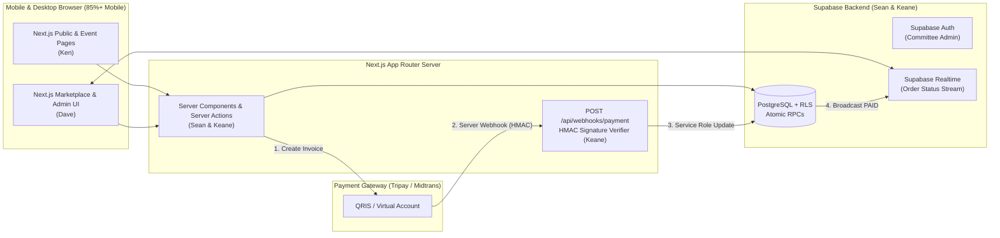
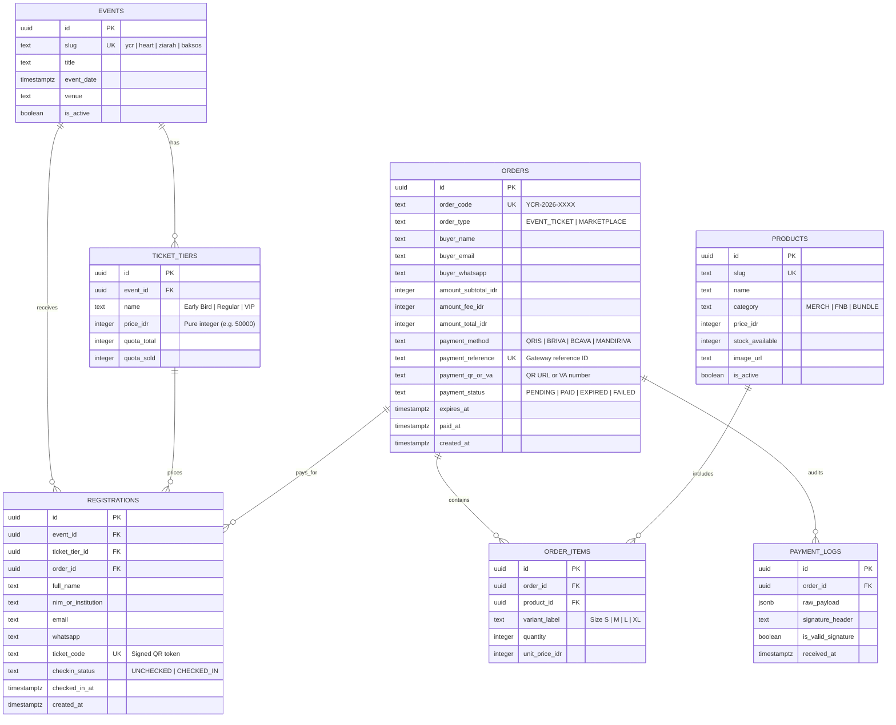

# ARCHITECTURE.md — Next.js + Supabase System Design & Contracts

> **Purpose**: Defines the directory structure, database schema (PostgreSQL/Supabase), Row Level Security (RLS) rules, and TypeScript/Zod contracts shared between **Frontend (Ken & Dave)** and **Backend (Sean & Keane)**.

---

## 1. High-Level System Architecture



---

## 2. Repository Directory Structure (Conflict-Free Ownership)

```text
├── AGENTS.md                          # Master AI instructions
├── CLAUDE.md                          # Claude Code entry pointer
├── docs/
│   ├── PRD.md                         # Product Requirements Document
│   ├── ARCHITECTURE.md                # System Architecture & Contracts
│   └── TEAM_WORKFLOW.md               # Role splits & AI prompts for Ken, Dave, Sean, Keane
├── supabase/                          # [OWNED BY: Sean & Keane]
│   ├── config.toml
│   ├── seed.sql
│   └── migrations/
│       ├── 0001_events_and_tickets.sql       # [Sean]
│       ├── 0002_marketplace_and_orders.sql   # [Keane]
│       └── 0003_rls_and_rpcs.sql             # [Sean & Keane]
└── src/
    ├── types/
    │   └── database.types.ts          # Auto-generated via `supabase gen types`
    ├── lib/
    │   ├── contracts/                 # [SHARED CONTRACT LAYER — Read before coding]
    │   │   ├── events.contract.ts
    │   │   ├── marketplace.contract.ts
    │   │   └── payments.contract.ts
    │   └── supabase/                  # [OWNED BY: Sean]
    │       ├── client.ts              # Browser client (@supabase/ssr)
    │       ├── server.ts              # RSC / Server Action client
    │       └── admin.ts               # Service-role client (WEBHOOKS ONLY)
    ├── services/                      # [OWNED BY: Sean & Keane — Backend Logic]
    │   ├── events.service.ts          # [Sean] Event & quota queries
    │   ├── registrations.service.ts   # [Sean] Participant registration & check-in
    │   ├── orders.service.ts          # [Keane] Atomic cart checkout & stock lock
    │   └── payments.service.ts        # [Keane] Midtrans/Tripay invoice + HMAC verify
    ├── components/                    # [OWNED BY: Ken & Dave — Frontend UI]
    │   ├── ui/                        # Shared shadcn/ui primitives
    │   ├── events/                    # [Ken] Hero, Schedule, RegForm, TicketCard
    │   ├── marketplace/               # [Dave] ProductGrid, CartDrawer, PaymentModal
    │   └── admin/                     # [Dave] KPIStats, OrdersTable, QRScanner
    └── app/
        ├── (public)/                  # [Ken] Home & KMK overview
        ├── events/                    # [Ken] /events/[slug], /events/[slug]/register
        ├── tickets/[code]/            # [Ken] Digital QR E-Ticket page
        ├── marketplace/               # [Dave] Merch & bundle storefront
        ├── admin/                     # [Dave] Committee dashboard & /admin/scan
        └── api/
            └── webhooks/
                └── payment/
                    └── route.ts       # [Keane] Payment gateway callback endpoint
```

---

## 3. Supabase Database Schema (ERD)



---

## 4. Shared Frontend–Backend Contracts (`src/lib/contracts/`)

Both Frontend (**Ken & Dave**) and Backend (**Sean & Keane**) must import these exact Zod schemas and return types so UI forms and Supabase services integrate with zero friction:

```typescript
// src/lib/contracts/index.ts
import { z } from 'zod';

// 1. Event Registration Request (Ken FE -> Sean BE)
export const CreateRegistrationSchema = z.object({
  eventSlug: z.enum(['ycr', 'heart', 'ziarah', 'baksos']),
  ticketTierId: z.string().uuid(),
  fullName: z.string().min(3).max(100),
  nimOrInstitution: z.string().min(2).max(100),
  email: z.string().email(),
  whatsapp: z.string().regex(/^(\+62|62|0)8[1-9][0-9]{6,11}$/, 'Invalid Indonesian WhatsApp number'),
  paymentMethod: z.enum(['FREE', 'QRIS', 'BCAVA', 'BRIVA', 'BNIVA', 'MANDIRIVA']),
});
export type CreateRegistrationInput = z.infer<typeof CreateRegistrationSchema>;

// 2. Marketplace Checkout Request (Dave FE -> Keane BE)
export const CreateMarketplaceOrderSchema = z.object({
  buyerName: z.string().min(3).max(100),
  buyerEmail: z.string().email(),
  buyerWhatsapp: z.string().regex(/^(\+62|62|0)8[1-9][0-9]{6,11}$/),
  paymentMethod: z.enum(['QRIS', 'BCAVA', 'BRIVA', 'BNIVA', 'MANDIRIVA']),
  items: z.array(
    z.object({
      productId: z.string().uuid(),
      variantLabel: z.string().optional(),
      quantity: z.number().int().min(1).max(10),
    })
  ).min(1),
});
export type CreateMarketplaceOrderInput = z.infer<typeof CreateMarketplaceOrderSchema>;

// 3. Unified Checkout Response (Sean/Keane BE -> Ken/Dave FE)
export interface CheckoutSessionResponse {
  orderCode: string;
  paymentStatus: 'PENDING' | 'PAID';
  amountTotalIdr: number;
  paymentMethod: string;
  qrImageUrl?: string;      // Populated when QRIS is selected
  vaNumber?: string;        // Populated when Virtual Account is selected
  snapToken?: string;       // Populated if using Midtrans Snap popup
  expiresAt: string;        // ISO8601 timestamp (15 mins from creation)
  ticketCode?: string;      // Immediately populated if event is FREE
}
```

---

## 5. Atomic Concurrency & RLS Rules (`Sean & Keane`)

1. **Preventing Overselling Under 100 Peak Users**:
   - Never do `SELECT stock` in TypeScript followed by `UPDATE stock = stock - 1` in a separate query.
   - Always use a PostgreSQL RPC function (`reserve_ticket_or_merch`) that locks the target row via `SELECT ... FOR UPDATE`, verifies `stock_available >= p_quantity`, decrements stock, and inserts the `orders` row in a single database transaction.
2. **Row Level Security (RLS) Matrix**:
   - `events`, `ticket_tiers`, `products`: `SELECT` open to `anon` and `authenticated` where `is_active = true`. Writes restricted to `authenticated` committee admins.
   - `registrations`, `orders`, `order_items`: Created via `SECURITY DEFINER` RPCs; `SELECT` allowed by matching `order_code` or `ticket_code` or committee admin role.
   - `payment_logs`: Strictly `service_role` only.
