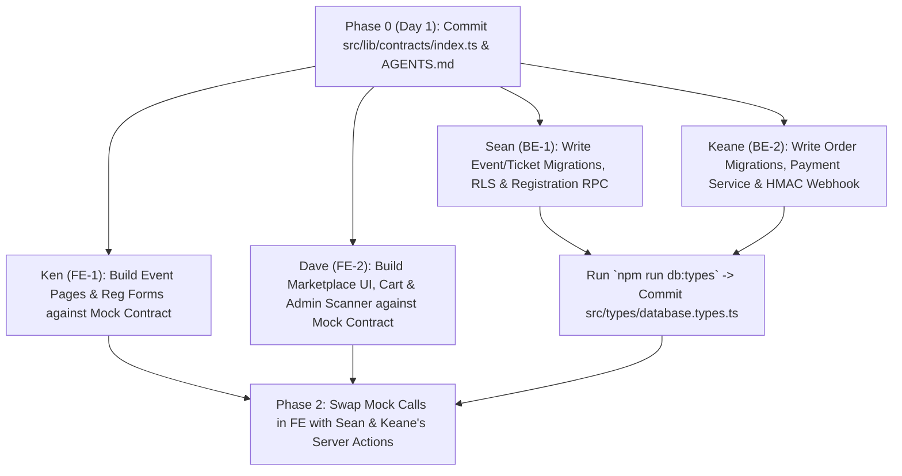

# TEAM_WORKFLOW.md — AI-Assisted Development Playbook (Ken, Dave, Sean, Keane)

> **How to use this file**: Each member of the PDD Website division has an isolated track, branch prefix, and ready-to-copy AI prompt. Paste your prompt into Claude Code / Antigravity / Cursor—it will automatically read `AGENTS.md`, `PRD.md`, and `ARCHITECTURE.md` so your code integrates cleanly with your teammates' work on the first try.

---

## 1. Team Tracks & Parallel Workstreams

| Track | Member | Branch Prefix | Primary Deliverables |
| :--- | :--- | :--- | :--- |
| **Track FE-1 (Events & Tickets)** | **Ken** (Kenneth Jonathan Halim) | `feat/fe-ken-*` | 1. YCR ("The Highway") Landing Page (`Hero`, `Speakers`, `Timeline`, `FAQ`)<br>2. Multi-event Registration Page (`/events/[slug]/register`) using `CreateRegistrationSchema`<br>3. Digital QR E-Ticket Page (`/tickets/[code]`) with downloadable QR card |
| **Track FE-2 (Marketplace & Admin)** | **Dave** (Dave Tristian Nurcahyo) | `feat/fe-dave-*` | 1. YCR Marketplace Catalog & Variant Selector (`/marketplace`)<br>2. Persistent Cart Drawer & Embedded QRIS/VA Payment Modal (`CheckoutSessionResponse`)<br>3. Committee Admin Dashboard (`/admin`) & Mobile Camera QR Gate Scanner (`/admin/scan`) |
| **Track BE-1 (Schema, Auth & Events)** | **Sean** (Sean Lawton) | `feat/be-sean-*` | 1. Supabase migrations `0001_events_and_tickets.sql` + `0003_rls_and_rpcs.sql`<br>2. Supabase SSR Client setup (`client.ts`, `server.ts`, `admin.ts`) & Committee Auth middleware<br>3. Atomic Ticket Registration RPC (`register_participant`) + QR Check-In verification RPC (`verify_and_checkin_ticket`) |
| **Track BE-2 (Orders, Stock & Payments)** | **Keane** (Keane Juan Suryanto) | `feat/be-keane-*` | 1. Supabase migration `0002_marketplace_and_orders.sql`<br>2. Atomic Marketplace Order & 15-min Stock Reservation RPC (`create_marketplace_order`)<br>3. Tripay/Midtrans Payment Service (`payments.service.ts`) & HMAC-verified Webhook (`POST /api/webhooks/payment`) |

---

## 2. Step-by-Step Integration Order (Zero Blockers)



1. **Contract Lock (Day 1)**: Commit `src/lib/contracts/index.ts` first.
2. **Parallel Build (Days 2–5)**:
   - **Ken & Dave** build and test all Next.js pages using mock functions that return `CheckoutSessionResponse`. They never wait on the database to build UI.
   - **Sean & Keane** write SQL migrations, test atomic stock/quota locking in Supabase, and wire the payment gateway sandbox.
3. **Wire-Up (Day 6)**: Replace the mock calls in Ken & Dave's forms with Sean & Keane's real services. Because both sides used `src/lib/contracts/index.ts`, TypeScript compiles with zero type mismatches.

---

## 3. Ready-to-Paste AI Prompts per Member

### For Ken — Frontend (Events, Registration & E-Ticket UI)
```text
Read AGENTS.md, PRD.md, and ARCHITECTURE.md first.
I am Ken (Frontend Track FE-1). Stay strictly inside `src/app/(public)/`, `src/app/events/`, `src/app/tickets/`, and `src/components/events/`.
Build:
1. The flagship landing page for Youth Catholic Revival ("The Highway") and dynamic event route `/events/[slug]` supporting `ycr`, `heart`, `ziarah`, and `baksos`.
2. The mobile-first registration form `/events/[slug]/register` validated with `CreateRegistrationSchema` from `src/lib/contracts/index.ts`.
3. The digital E-Ticket view `/tickets/[code]` that renders the participant's QR code, ticket tier, check-in status badge, and a "Save Ticket Image" button.
Ensure all components are mobile-first (44x44px tap targets) and use React Server Components by default with `'use client'` only on leaf interactive elements.
```

### For Dave — Frontend (Marketplace, Payment Modal & Admin Scanner)
```text
Read AGENTS.md, PRD.md, and ARCHITECTURE.md first.
I am Dave (Frontend Track FE-2). Stay strictly inside `src/app/marketplace/`, `src/app/admin/`, `src/components/marketplace/`, and `src/components/admin/`.
Build:
1. The YCR Marketplace storefront (`/marketplace`) with category filtering (MERCH, FNB, BUNDLE), size variant selection, live stock badges, and a persistent slide-over Cart Drawer validated with `CreateMarketplaceOrderSchema`.
2. The embedded Payment Modal that accepts `CheckoutSessionResponse`, renders the QRIS image or Virtual Account number with a 15-minute countdown timer, and listens to Supabase Realtime on `orders` to auto-transition to "Payment Successful!" when `payment_status === 'PAID'`.
3. The Committee Admin Dashboard (`/admin`) with KPI cards, CSV export, and the mobile camera QR check-in scanner (`/admin/scan`).
```

### For Sean — Backend (Supabase Schema, RLS, Auth & Event Registration)
```text
Read AGENTS.md, PRD.md, and ARCHITECTURE.md first.
I am Sean (Backend Track BE-1). Stay strictly inside `supabase/migrations/`, `src/lib/supabase/`, `src/services/events.service.ts`, and `src/services/registrations.service.ts`.
Build:
1. Supabase SQL migration `0001_events_and_tickets.sql` creating `events`, `ticket_tiers`, and `registrations` tables with indexes and RLS policies.
2. A PostgreSQL transactional RPC `register_participant` that locks the `ticket_tiers` row (`FOR UPDATE`), verifies `quota_sold < quota_total`, increments `quota_sold`, and creates the registration + order atomically.
3. The committee QR check-in service `verifyAndCheckInTicket(ticketCode)` that atomically marks `checkin_status = 'CHECKED_IN'` and returns a clear error if already scanned.
```

### For Keane — Backend (Marketplace Orders, Stock Locking & Payment Webhooks)
```text
Read AGENTS.md, PRD.md, and ARCHITECTURE.md first.
I am Keane (Backend Track BE-2). Stay strictly inside `supabase/migrations/0002_marketplace_and_orders.sql`, `src/services/orders.service.ts`, `src/services/payments.service.ts`, and `src/app/api/webhooks/payment/route.ts`.
Build:
1. Supabase SQL migration `0002_marketplace_and_orders.sql` creating `products`, `orders`, `order_items`, and `payment_logs` with RLS enabled.
2. A PostgreSQL transactional RPC `create_marketplace_order` that locks product rows (`FOR UPDATE`), verifies `stock_available >= quantity`, deducts stock, and creates the `PENDING` order with a 15-minute expiry.
3. The Tripay/Midtrans invoice generator in `src/services/payments.service.ts` returning `CheckoutSessionResponse`.
4. The idempotent webhook handler `POST /api/webhooks/payment/route.ts` that logs the raw callback to `payment_logs`, verifies the HMAC signature, updates `orders.payment_status` to `PAID` (or restores stock on `EXPIRED`/`FAILED`), and generates `ticket_code` if `order_type === 'EVENT_TICKET'`.
```

---

## 4. Git & Pull Request Rules

1. **Never push directly to `main`**. Branch using your prefix (`feat/fe-ken-*`, `feat/fe-dave-*`, `feat/be-sean-*`, `feat/be-keane-*`).
2. **Pre-PR Checklist**:
   - Run `npm run typecheck && npm run lint && npm run build` locally before opening a PR.
   - If you touched `supabase/migrations/`, run `npm run db:types` and commit the updated `src/types/database.types.ts` in the same PR.
3. **Environment Secrets**:
   - `NEXT_PUBLIC_SUPABASE_URL` and `NEXT_PUBLIC_SUPABASE_ANON_KEY` are safe for browser use.
   - `SUPABASE_SERVICE_ROLE_KEY`, `PAYMENT_GATEWAY_API_KEY`, and `PAYMENT_GATEWAY_PRIVATE_KEY` must **never** be prefixed with `NEXT_PUBLIC_` or committed to Git.
