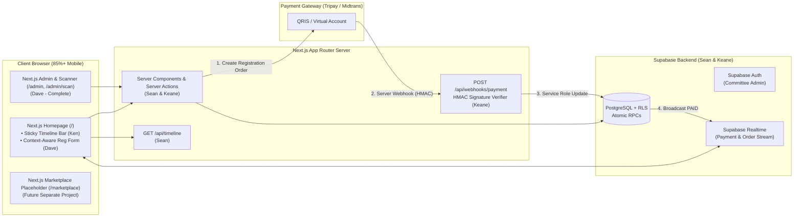
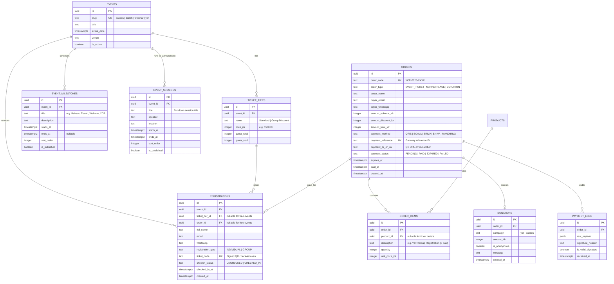

# ARCHITECTURE.md — Next.js + Supabase System Design & Contracts

> **Purpose**: Defines the directory structure, database schema (PostgreSQL/Supabase), Row Level Security (RLS) rules, and TypeScript/Zod contracts shared between **Frontend (Ken & Dave)** and **Backend (Sean & Keane)** under the unified single-page architecture.

---

## 1. High-Level System Architecture



---

## 2. Repository Directory Structure (Conflict-Free Ownership)

```text
├── AGENTS.md                          # [Gee] Master AI agent rules & directory boundaries
├── CLAUDE.md                          # [Gee] Claude Code entry pointer
├── README.md                          # [shared] Repository overview & quick start
├── docs/                              # [Gee]
│   ├── PLAYBOOK.md                    # Master AI-assisted development playbook
│   ├── PRD.md                         # Product Requirements Document
│   ├── ARCHITECTURE.md                # System Architecture & Contracts (this file)
│   ├── TECH_STACK.md                  # Libraries & versions
│   ├── TEAM_WORKFLOW.md               # Tracks, integration order, AI prompts
│   └── DESIGN.md                      # [Dave] Design system ("Sunlit Highway")
├── supabase/
│   ├── config.toml                    # [Sean]
│   ├── seed.sql                       # [shared]
│   └── migrations/                    # [shared folder — new file per change, never edit another's]
│       ├── 0001_events_and_tickets.sql       # [Sean]
│       ├── 0002_marketplace_and_orders.sql   # [Keane]
│       ├── 0003_rls_and_rpcs.sql             # [Sean]  events/registrations RLS + RPCs
│       ├── 0004_event_timeline.sql           # [Sean]  event_milestones
│       ├── 0005_donations.sql                # [Keane] donations + DONATION order type (backend)
│       └── 0006_event_rundown.sql            # [Sean]  event_sessions (D-Day rundown)
└── src/
    ├── middleware.ts                  # [Sean] Protects /admin with Supabase Auth
    ├── types/
    │   └── database.types.ts          # [shared, generated] `npm run db:types` only
    ├── lib/
    │   ├── contracts/                 # [SHARED CONTRACT LAYER — Read before coding]
    │   │   ├── index.ts               # Re-exports active contracts
    │   │   ├── common.contract.ts     # Shared field schemas (WhatsApp, payment methods)
    │   │   ├── registration.contract.ts # [NEW] Dave ↔ Sean/Keane (Webinar, YCR Indiv/Group)
    │   │   ├── timeline.contract.ts   # Ken ↔ Sean (Milestones & D-Day Rundown)
    │   │   ├── admin.contract.ts      # Dave ↔ Sean (Dashboard KPIs & reporting)
    │   │   ├── marketplace.contract.ts# Dave ↔ Keane (Placeholder contract)
    │   │   ├── donations.contract.ts  # Keane (Retained for backend use; unused on FE)
    │   │   └── payments.contract.ts   # All (CheckoutSessionResponse)
    │   └── supabase/                  # [Sean]
    │       ├── client.ts              # Browser client (@supabase/ssr)
    │       ├── server.ts              # RSC / Server Action client
    │       └── admin.ts               # Service-role client (WEBHOOKS ONLY)
    ├── services/                      # Backend logic (Server Actions / server-only)
    │   ├── events.service.ts          # [Sean]  Events query
    │   ├── registrations.service.ts   # [Sean]  Registration & check-in RPC wrappers
    │   ├── timeline.service.ts        # [Sean]  Milestones & D-Day rundown data
    │   ├── admin.service.ts           # [Sean]  Dashboard KPIs & CSV export queries
    │   ├── orders.service.ts          # [Keane] Orders creation & pricing verification
    │   ├── donations.service.ts       # [Keane] Backend donation service (external use)
    │   └── payments.service.ts        # [Keane] Tripay/Midtrans invoice & HMAC verify
    ├── components/
    │   ├── ui/                        # [Ken]  Shared shadcn/ui primitives
    │   ├── layout/                    # [Ken]  Root layout, sticky header container, footer
    │   ├── timeline/                  # [Ken]  Sticky Timeline Bar (TimelineBar.tsx, TimelineModal.tsx, mock-timeline.ts)
    │   ├── registration/              # [Dave] Context-aware form (RegistrationForm, WebinarForm, YcrForm, PriceSummary)
    │   ├── marketplace/               # [Dave] Placeholder components (future separate project)
    │   └── admin/                     # [Dave] Dashboard (KpiCards, AdminTables, GateScanner) — Complete
    └── app/
        ├── layout.tsx                 # [Ken]  Root layout
        ├── globals.css                # [shared] imports tokens.css
        ├── tokens.css                 # [Ken]  Design tokens from docs/DESIGN.md
        ├── (public)/page.tsx          # [Ken & Dave] Main homepage (Timeline Bar + Reg Form)
        ├── mock-registration.ts       # [Dave] Mock registration submit handler
        ├── marketplace/               # [Dave] Placeholder stub route
        ├── admin/                     # [Dave] Committee dashboard & /admin/scan (Complete)
        └── api/
            ├── timeline/
            │   └── route.ts           # [Sean] GET /api/timeline → EventTimelineResponse
            └── webhooks/
                └── payment/
                    └── route.ts       # [Keane] Payment gateway callback endpoint
```

> **Note on `/donate` Removal**: The `/donate` route and `src/components/donation/` have been removed from the frontend UI. Public donations will be managed by the marketplace website. `src/lib/contracts/donations.contract.ts` and `src/services/donations.service.ts` remain for Keane's backend processing.

---

## 3. Supabase Database Schema (ERD)



---

## 4. Shared Frontend–Backend Contracts (`src/lib/contracts/`)

All schemas utilize standard Zod 4 syntax (`z.email()`, `z.uuid()`).

### 4.1 Common & Shared Types (`src/lib/contracts/common.contract.ts`)
```typescript
import { z } from 'zod';

export const WhatsappSchema = z
  .string()
  .regex(/^(\+62|62|0)8[1-9][0-9]{6,11}$/, 'Invalid Indonesian WhatsApp number');

export const PaidMethodSchema = z.enum(['QRIS', 'BCAVA', 'BRIVA', 'BNIVA', 'MANDIRIVA']);
export type PaidMethod = z.infer<typeof PaidMethodSchema>;
```

### 4.2 Context-Aware Registration (`src/lib/contracts/registration.contract.ts`)
```typescript
import { z } from 'zod';
import { WhatsappSchema, PaidMethodSchema } from './common.contract';

// Reusable member schema
export const MemberSchema = z.object({
  fullName: z.string().min(3).max(100),
  email: z.email(),
  whatsapp: WhatsappSchema,
});
export type Member = z.infer<typeof MemberSchema>;

// Webinar Registration (Individual only)
export const CreateWebinarRegistrationSchema = z.object({
  fullName: z.string().min(3).max(100),
  email: z.email(),
  whatsapp: WhatsappSchema,
});
export type CreateWebinarRegistrationInput = z.infer<typeof CreateWebinarRegistrationSchema>;

// YCR Individual Registration
export const CreateYcrRegistrationSchema = z.object({
  member: MemberSchema,
});
export type CreateYcrRegistrationInput = z.infer<typeof CreateYcrRegistrationSchema>;

// YCR Group Registration (Leader is members[0] + dynamically appended members)
export const CreateYcrGroupSchema = z.object({
  members: z.array(MemberSchema).min(1),
  paymentMethod: PaidMethodSchema,
});
export type CreateYcrGroupInput = z.infer<typeof CreateYcrGroupSchema>;
```

### 4.3 Sticky Timeline Bar & D-Day Rundown (`src/lib/contracts/timeline.contract.ts`)
> **Contract Reuse**: The existing `TimelineMilestone` and `RundownSession` interfaces are directly reused to power the Sticky Timeline Bar.

```typescript
export interface TimelineMilestone {
  id: string;
  title: string;             // e.g. "Baksos", "Ziarah", "Webinar", "YCR"
  description: string | null; // Venue, short context
  startsAt: string;          // ISO8601
  endsAt: string | null;     // ISO8601
  state: 'PAST' | 'NOW' | 'UPCOMING';
}

export interface RundownSession {
  id: string;
  title: string;             // Session title
  speaker: string | null;    // Guest speaker / worship leader
  location: string | null;   // Room / Stage
  startsAt: string;          // ISO8601
  endsAt: string;            // ISO8601
}

export interface EventTimelineResponse {
  eventSlug: 'baksos' | 'ziarah' | 'webinar' | 'ycr';
  milestones: TimelineMilestone[];
  rundown: RundownSession[];  // Populated for D-Day mode
}
```

- **Pre-D-Day**: The bar displays the 4 milestone nodes (`milestones`) with states:
  - `PAST` = filled green
  - `NOW` = pulsing gold
  - `UPCOMING` = hollow circle
  - Hover triggers 1-line tooltip; click opens `TimelineModal`.
- **D-Day Mode**: Triggered automatically when `Date.now() >= YCR_DATE_MIDNIGHT`. The bar transitions to display `rundown` sessions chronologically with the identical visual progress bar and modal interactions.

### 4.4 Checkout & Payment Response (`src/lib/contracts/payments.contract.ts`)
```typescript
export interface CheckoutSessionResponse {
  orderCode: string;
  orderType: 'EVENT_TICKET' | 'MARKETPLACE' | 'DONATION';
  paymentStatus: 'PENDING' | 'PAID';
  amountTotalIdr: number;
  paymentMethod: string;
  qrImageUrl?: string;      // Populated when QRIS is selected
  vaNumber?: string;        // Populated when Virtual Account is selected
  snapToken?: string;       // Populated if using Midtrans Snap modal
  expiresAt: string;        // ISO8601 timestamp (15 mins from creation)
  ticketCode?: string;      // Populated if registration is FREE (e.g. Webinar)
}
```

### 4.5 Backend Donations Contract (`src/lib/contracts/donations.contract.ts`)
*(Retained in codebase for Keane's backend use; not exported to frontend index).*
```typescript
import { z } from 'zod';
import { WhatsappSchema, PaidMethodSchema } from './common.contract';

export const CreateDonationSchema = z.object({
  campaign: z.enum(['ycr', 'baksos']),
  amountIdr: z.number().int().positive(),
  donorName: z.string().min(3).max(100),
  donorEmail: z.email(),
  donorWhatsapp: WhatsappSchema,
  isAnonymous: z.boolean().default(false),
  message: z.string().max(280).optional(),
  paymentMethod: PaidMethodSchema,
});
export type CreateDonationInput = z.infer<typeof CreateDonationSchema>;
```

---

## 5. Atomic Concurrency & RLS Rules (`Sean & Keane`)

1. **Atomic Group Registration & Quota Locking**:
   - For YCR registrations, frontend submits `members: Member[]`.
   - Backend RPC function (`register_ycr_group`) verifies quota availability using `SELECT quota_sold, quota_total FROM ticket_tiers WHERE ... FOR UPDATE`.
   - Atomically increments `quota_sold = quota_sold + array_length(members)` and inserts registration records linked to the newly generated `orders` record.
2. **Tiered Pricing Calculation (Server-Validated)**:
   - Price calculation on server enforces volume discounts:
     - 1–4 members: Rp 150.000 / member
     - 5–9 members: Rp 135.000 / member (10% off)
     - $\ge$ 10 members: Rp 120.000 / member (20% off)
   - Prevents client-side price tampering.
3. **Webhook Verification (`Keane`)**:
   - `POST /api/webhooks/payment/route.ts` verifies HMAC-SHA256 signature.
   - Transitions order status to `PAID`.
   - On payment confirmation, generates unique QR `ticket_code`s for all registered group members and updates `registrations.checkin_status = 'UNCHECKED'`.
4. **Row Level Security (RLS)**:
   - `events`, `event_milestones`, `event_sessions`: public `SELECT` where `is_published = true`.
   - `registrations`: `INSERT` via verified RPC; `SELECT` restricted to committee admin auth or verified `ticket_code`.
   - `payment_logs`: strictly restricted to `service_role`.
