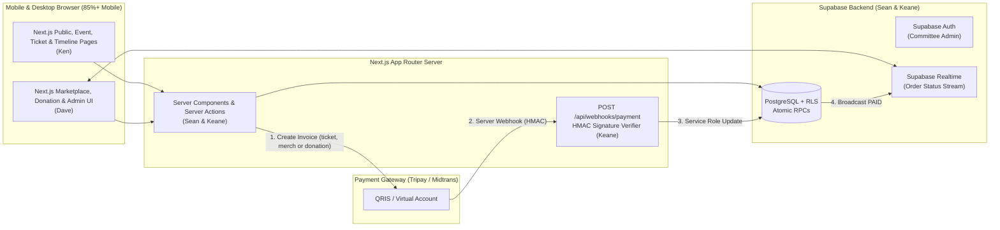
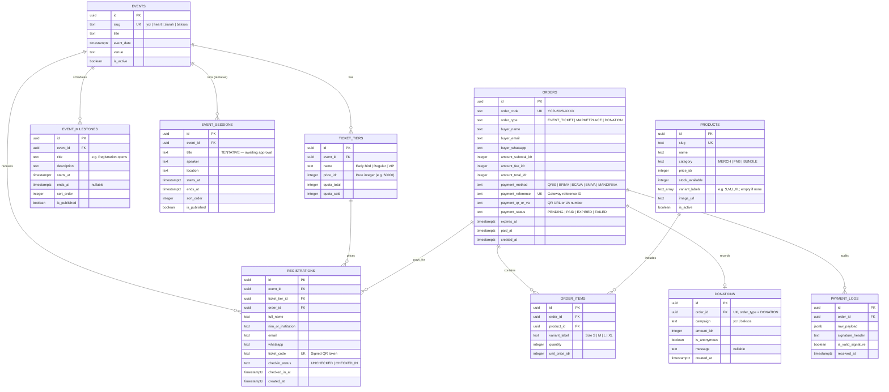

# ARCHITECTURE.md — Next.js + Supabase System Design & Contracts

> **Purpose**: Defines the directory structure, database schema (PostgreSQL/Supabase), Row Level Security (RLS) rules, and TypeScript/Zod contracts shared between **Frontend (Ken & Dave)** and **Backend (Sean & Keane)**. Exact file ownership lives in the local-only `owners.txt` (ask **Gee**, the coordinator).

---

## 1. High-Level System Architecture



---

## 2. Repository Directory Structure (Conflict-Free Ownership)

```text
├── AGENTS.md                          # [LOCAL ONLY — Gee] Master AI agent rules
├── CLAUDE.md                          # [LOCAL ONLY — Gee] Points Claude Code to AGENTS.md
├── owners.txt                         # [LOCAL ONLY — Gee] File & task ownership
├── schedule.txt                       # [LOCAL ONLY — Gee] Dated task list
├── README.md                          # [shared]
├── docs/                              # [Gee]
│   ├── PRD.md                         # Product Requirements Document
│   ├── ARCHITECTURE.md                # System Architecture & Contracts (this file)
│   ├── TECH_STACK.md                  # Libraries & versions
│   ├── TEAM_WORKFLOW.md               # Tracks, integration order, AI prompts
│   └── DESIGN.md                      # [Dave] Design system ("Sunlit Highway")
├── supabase/
│   ├── config.toml                    # [Sean]
│   ├── seed.sql                       # [shared]
│   └── migrations/                    # [shared folder — new file per change, never edit another's]
│       ├── 0001_events_and_tickets.sql       # [Sean]
│       ├── 0002_marketplace_and_orders.sql   # [Keane]
│       ├── 0003_rls_and_rpcs.sql             # [Sean]  events/registrations RLS + RPCs
│       ├── 0004_event_timeline.sql           # [Sean]  event_milestones
│       ├── 0005_donations.sql                # [Keane] donations + DONATION order type
│       └── 0006_event_rundown.sql            # [Sean]  event_sessions (tentative)
└── src/
    ├── middleware.ts                  # [Sean] Protects /admin with Supabase Auth
    ├── types/
    │   └── database.types.ts          # [shared, generated] `npm run db:types` only
    ├── lib/
    │   ├── contracts/                 # [SHARED CONTRACT LAYER — Read before coding]
    │   │   ├── index.ts               # Re-exports every contract
    │   │   ├── common.contract.ts     # Shared field schemas (WhatsApp, payment method)
    │   │   ├── events.contract.ts     # Ken ↔ Sean
    │   │   ├── timeline.contract.ts   # Ken ↔ Sean
    │   │   ├── marketplace.contract.ts# Dave ↔ Keane
    │   │   ├── donations.contract.ts  # Dave ↔ Keane
    │   │   └── payments.contract.ts   # All (CheckoutSessionResponse)
    │   └── supabase/                  # [Sean]
    │       ├── client.ts              # Browser client (@supabase/ssr)
    │       ├── server.ts              # RSC / Server Action client
    │       └── admin.ts               # Service-role client (WEBHOOKS ONLY)
    ├── services/                      # Backend logic (Server Actions / server-only)
    │   ├── events.service.ts          # [Sean]  Events & quota queries
    │   ├── registrations.service.ts   # [Sean]  Registration & check-in
    │   ├── timeline.service.ts        # [Sean]  Milestones (+ rundown, tentative)
    │   ├── admin.service.ts           # [Sean]  Dashboard KPIs & CSV export queries
    │   ├── orders.service.ts          # [Keane] Atomic cart checkout & stock lock
    │   ├── donations.service.ts       # [Keane] Donation order creation
    │   └── payments.service.ts        # [Keane] Tripay/Midtrans invoice + HMAC verify
    ├── components/
    │   ├── ui/                        # [Ken]  Shared shadcn/ui primitives — ask Ken for new ones
    │   ├── layout/                    # [Ken]  Header, footer, mobile nav
    │   ├── events/                    # [Ken]  Hero, Speakers, RegForm, TicketCard
    │   ├── timeline/                  # [Ken]  MilestoneList, RundownSection
    │   ├── marketplace/               # [Dave] ProductGrid, CartDrawer, PaymentModal
    │   ├── donation/                  # [Dave] DonationForm, AmountPicker, ThankYou
    │   └── admin/                     # [Dave] KPIStats, OrdersTable, QRScanner
    └── app/
        ├── layout.tsx                 # [Ken]  Root layout
        ├── globals.css                # [shared] imports tokens.css
        ├── tokens.css                 # [Ken]  Design tokens from docs/DESIGN.md (light + dark)
        ├── (public)/                  # [Ken]  Home & KMK overview
        ├── events/                    # [Ken]  /events/[slug], /events/[slug]/register
        ├── tickets/[code]/            # [Ken]  Digital QR E-Ticket page
        ├── timeline/                  # [Ken]  /timeline
        ├── marketplace/               # [Dave] Merch & bundle storefront
        ├── donate/                    # [Dave] /donate
        ├── admin/                     # [Dave] Committee dashboard & /admin/scan
        └── api/
            └── webhooks/
                └── payment/
                    └── route.ts       # [Keane] Payment gateway callback endpoint
```

---

## 3. Supabase Database Schema (ERD)



---

## 4. Shared Frontend–Backend Contracts (`src/lib/contracts/`)

Both Frontend (**Ken & Dave**) and Backend (**Sean & Keane**) import these exact Zod schemas and types (Zod 4 syntax: `z.email()`, `z.uuid()`). The live source is `src/lib/contracts/`; if this section and the code disagree, the code wins and this section gets updated. Each contract file is split by domain (see section 2) and re-exported from `index.ts`, so `import { ... } from '@/lib/contracts'` always works. Changing an existing schema needs the agreement of its frontend–backend pair, confirmed in the team chat before merging into `main`.

```typescript
// src/lib/contracts/common.contract.ts
import { z } from 'zod';

export const WhatsappSchema = z
  .string()
  .regex(/^(\+62|62|0)8[1-9][0-9]{6,11}$/, 'Invalid Indonesian WhatsApp number');

export const PaidMethodSchema = z.enum(['QRIS', 'BCAVA', 'BRIVA', 'BNIVA', 'MANDIRIVA']);

// src/lib/contracts/events.contract.ts  (Ken FE -> Sean BE)
export const CreateRegistrationSchema = z.object({
  eventSlug: z.enum(['ycr', 'heart', 'ziarah', 'baksos']),
  ticketTierId: z.uuid(),
  fullName: z.string().min(3).max(100),
  nimOrInstitution: z.string().min(2).max(100),
  email: z.email(),
  whatsapp: WhatsappSchema,
  paymentMethod: z.union([z.literal('FREE'), PaidMethodSchema]),
});
export type CreateRegistrationInput = z.infer<typeof CreateRegistrationSchema>;

// src/lib/contracts/marketplace.contract.ts  (Dave FE <-> Keane BE)
export const ProductCategorySchema = z.enum(['MERCH', 'FNB', 'BUNDLE']);
export type ProductCategory = z.infer<typeof ProductCategorySchema>;

// Catalog read model (Keane BE -> Dave FE)
export interface ProductSummary {
  id: string;
  slug: string;
  name: string;
  category: ProductCategory;
  priceIdr: number;
  stockAvailable: number;
  imageUrl: string | null;
  variantLabels: string[];   // from products.variant_labels; [] when the product has no sizes/options
}

export const CreateMarketplaceOrderSchema = z.object({
  buyerName: z.string().min(3).max(100),
  buyerEmail: z.email(),
  buyerWhatsapp: WhatsappSchema,
  paymentMethod: PaidMethodSchema,
  items: z.array(
    z.object({
      productId: z.uuid(),
      variantLabel: z.string().optional(),
      quantity: z.number().int().min(1).max(10),
    })
  ).min(1),
});
export type CreateMarketplaceOrderInput = z.infer<typeof CreateMarketplaceOrderSchema>;

// src/lib/contracts/donations.contract.ts  (Dave FE -> Keane BE)
// The minimum amount is an open decision for Gee / the committee; Keane sets DONATION_MIN_IDR once decided.
export const CreateDonationSchema = z.object({
  campaign: z.enum(['ycr', 'baksos']),
  amountIdr: z.number().int().positive(),
  donorName: z.string().min(3).max(100),
  donorEmail: z.email(),
  donorWhatsapp: WhatsappSchema,
  isAnonymous: z.boolean().default(false),
  message: z.string().max(280).optional(),
  paymentMethod: PaidMethodSchema,
});
export type CreateDonationInput = z.infer<typeof CreateDonationSchema>;

// src/lib/contracts/timeline.contract.ts  (Sean BE -> Ken FE)
export interface TimelineMilestone {
  id: string;
  title: string;
  description: string | null;
  startsAt: string;          // ISO8601
  endsAt: string | null;     // ISO8601
  state: 'PAST' | 'NOW' | 'UPCOMING';
}

// Tentative: shape may change once the rundown is approved.
export interface RundownSession {
  id: string;
  title: string;
  speaker: string | null;
  location: string | null;
  startsAt: string;
  endsAt: string;
}

export interface EventTimelineResponse {
  eventSlug: 'ycr' | 'heart' | 'ziarah' | 'baksos';
  milestones: TimelineMilestone[];
  rundown: RundownSession[];  // empty until the rundown is approved and published
}

// src/lib/contracts/payments.contract.ts  (Sean/Keane BE -> Ken/Dave FE)
export interface CheckoutSessionResponse {
  orderCode: string;
  orderType: 'EVENT_TICKET' | 'MARKETPLACE' | 'DONATION';
  paymentStatus: 'PENDING' | 'PAID';
  amountTotalIdr: number;
  paymentMethod: string;
  qrImageUrl?: string;      // Populated when QRIS is selected
  vaNumber?: string;        // Populated when Virtual Account is selected
  snapToken?: string;       // Populated if using Midtrans Snap popup
  expiresAt: string;        // ISO8601 timestamp (15 mins from creation)
  ticketCode?: string;      // Immediately populated if event is FREE
}
```

---

## 5. Atomic Concurrency & RLS Rules (`Sean & Keane`)

1. **Preventing Overselling Under 100 Peak Users**:
   - Never do `SELECT stock` in TypeScript followed by `UPDATE stock = stock - 1` in a separate query.
   - Always use a PostgreSQL RPC function (`register_participant`, `create_marketplace_order`) that locks the target row via `SELECT ... FOR UPDATE`, verifies `stock_available >= p_quantity` (or `quota_sold < quota_total`), decrements stock, and inserts the `orders` row in a single database transaction.
   - Donations have no stock; `create_donation` only inserts the `orders` (`DONATION`) and `donations` rows in one transaction.
2. **Webhook Rules (Keane)**:
   - `EVENT_TICKET` → mark registration paid and generate `ticket_code`.
   - `MARKETPLACE` → mark paid; on `EXPIRED`/`FAILED` restore reserved stock.
   - `DONATION` → mark paid; nothing to restore.
   - Already `PAID` → return `200 OK` and do nothing (idempotent).
3. **Row Level Security (RLS) Matrix**:
   - `events`, `ticket_tiers`, `products`, `event_milestones`, `event_sessions`: `SELECT` open to `anon` and `authenticated` where `is_active = true` / `is_published = true`. Writes restricted to `authenticated` committee admins.
   - `registrations`, `orders`, `order_items`, `donations`: created via `SECURITY DEFINER` RPCs; `SELECT` allowed by matching `order_code` or `ticket_code`, or by committee admin role.
   - `payment_logs`: strictly `service_role` only.
