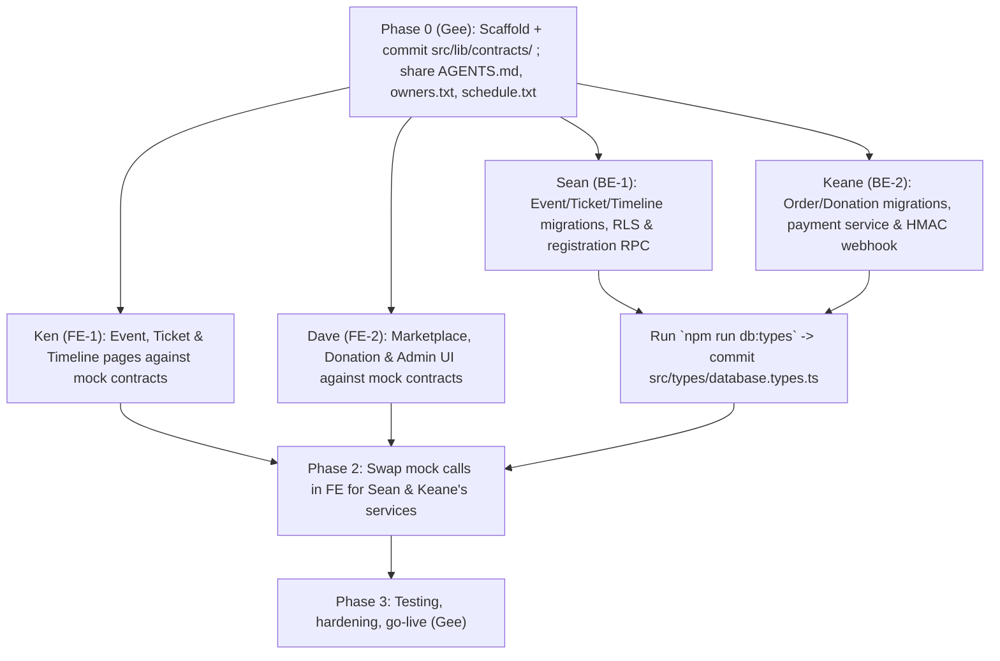

# TEAM_WORKFLOW.md — AI-Assisted Development Playbook (Gee, Ken, Dave, Sean, Keane)

> **How to use this file**: Each member of the PDD Website division has an isolated track, branch prefix, and ready-to-copy AI prompt. Paste your prompt into Claude Code / Antigravity / Cursor. Your agent must first read the local-only `AGENTS.md`, `owners.txt` and `schedule.txt` (get them from **Gee**), then `docs/PRD.md` and `docs/ARCHITECTURE.md`, so your code integrates cleanly with your teammates' work on the first try.

---

## 1. Team Tracks & Parallel Workstreams

Task IDs and dates live in `schedule.txt`. Branch name = prefix + the task's feature name in kebab-case (e.g. `DV06 Donation page` → `feat/fe-dave-donation-page`).

| Track | Member | Branch Prefix | Primary Deliverables |
| :--- | :--- | :--- | :--- |
| **Coordination** | **Gee** | `chore/gee-*` | 1. Agent rules, `owners.txt`, `schedule.txt` (local only)<br>2. Next.js + Supabase scaffold and shared contracts lock<br>3. Staging deployment, end-to-end test with the committee, go-live |
| **Track FE-1 (Events, Tickets & Timeline)** | **Ken** (Kenneth Jonathan Halim) | `feat/fe-ken-*` | 1. Shared UI kit and site layout<br>2. YCR ("The Highway") Landing Page (`Hero`, `Speakers`, `FAQ`) and event hub (`/events/[slug]`)<br>3. Registration Page (`/events/[slug]/register`) using `CreateRegistrationSchema`<br>4. Digital QR E-Ticket Page (`/tickets/[code]`)<br>5. Event Timeline Page (`/timeline`) using `EventTimelineResponse` — rundown section **tentative** |
| **Track FE-2 (Marketplace, Donation & Admin)** | **Dave** (Dave Tristian Nurcahyo) | `feat/fe-dave-*` | 1. YCR Marketplace Catalog & Variant Selector (`/marketplace`)<br>2. Persistent Cart Drawer & Embedded QRIS/VA Payment Modal (`CheckoutSessionResponse`)<br>3. Donation Page (`/donate`) using `CreateDonationSchema`, reusing the payment modal<br>4. Committee Admin Dashboard (`/admin`) & Mobile Camera QR Gate Scanner (`/admin/scan`) |
| **Track BE-1 (Schema, Auth, Events & Timeline)** | **Sean** (Sean Lawton) | `feat/be-sean-*` | 1. Migrations `0001_events_and_tickets.sql`, `0003_rls_and_rpcs.sql`, `0004_event_timeline.sql` (+ `0006_event_rundown.sql`, tentative)<br>2. Supabase SSR clients (`client.ts`, `server.ts`, `admin.ts`) & `/admin` auth middleware<br>3. Atomic Registration RPC (`register_participant`) + QR Check-In RPC (`verify_and_checkin_ticket`)<br>4. Timeline service and admin reporting queries |
| **Track BE-2 (Orders, Donations & Payments)** | **Keane** (Keane Juan Suryanto) | `feat/be-keane-*` | 1. Migrations `0002_marketplace_and_orders.sql`, `0005_donations.sql`<br>2. Atomic Marketplace Order & 15-min Stock Reservation RPC (`create_marketplace_order`)<br>3. Donation order RPC (`create_donation`) and `donations.service.ts`<br>4. Tripay/Midtrans Payment Service & HMAC-verified Webhook (`POST /api/webhooks/payment`) |

---

## 2. Step-by-Step Integration Order (Zero Blockers)



1. **Contract Lock (Phase 0)**: Gee commits `src/lib/contracts/` first. Nobody builds before the contracts exist.
2. **Parallel Build (Phase 1)**:
   - **Ken & Dave** build and test every page with mock functions that return the contract types. They never wait on the database.
   - **Sean & Keane** write SQL migrations, test atomic stock/quota locking in local Supabase, and wire the payment gateway sandbox.
3. **Wire-Up (Phase 2)**: Replace the mocks with the real services. Because both sides used `src/lib/contracts/`, TypeScript compiles with no type mismatches.
4. **Tentative work**: the event-day rundown (`SN08`, `KN08`) waits on approval from the KMK leadership. Do not start it until Gee removes `(tentative)` in `schedule.txt`.

---

## 3. Ready-to-Paste AI Prompts per Member

### For Ken — Frontend (Events, Registration, E-Ticket & Timeline UI)
```text
Read AGENTS.md, owners.txt, schedule.txt, docs/PRD.md and docs/ARCHITECTURE.md first, and follow the ownership gate in AGENTS.md.
I am Ken (Frontend Track FE-1). Stay inside the paths owners.txt gives Kenneth.
My current task is <task ID from schedule.txt>. Build only that task, on its branch.
Context for my track:
1. The flagship landing page for Youth Catholic Revival ("The Highway") and dynamic event route `/events/[slug]` supporting `ycr`, `heart`, `ziarah`, `baksos`. Baksos's "Donate" button links to `/donate?campaign=baksos`.
2. The mobile-first registration form `/events/[slug]/register` validated with `CreateRegistrationSchema`.
3. The digital E-Ticket view `/tickets/[code]` with QR code, ticket tier, check-in badge and a "Save Ticket Image" button.
4. The `/timeline` page rendering `EventTimelineResponse.milestones` as a vertical list with past/now/upcoming states, leaving an empty rundown section that only renders when `rundown` is non-empty.
Mobile-first (44x44px tap targets), Server Components by default, 'use client' only on leaf interactive elements.
```

### For Dave — Frontend (Marketplace, Payment Modal, Donation & Admin Scanner)
```text
Read AGENTS.md, owners.txt, schedule.txt, docs/PRD.md and docs/ARCHITECTURE.md first, and follow the ownership gate in AGENTS.md.
I am Dave (Frontend Track FE-2). Stay inside the paths owners.txt gives Dave.
My current task is <task ID from schedule.txt>. Build only that task, on its branch.
Context for my track:
1. The YCR Marketplace (`/marketplace`) with category filter (MERCH, FNB, BUNDLE), size variants, live stock badges, and a persistent Cart Drawer validated with `CreateMarketplaceOrderSchema`.
2. The embedded Payment Modal that accepts `CheckoutSessionResponse`, shows the QRIS image or VA number with a 15-minute countdown, and listens to Supabase Realtime on `orders` to switch to "Payment Successful!" when `payment_status === 'PAID'`.
3. The `/donate` page (campaign `ycr` | `baksos` from `?campaign=`, preset + custom amount, anonymous toggle, optional message) validated with `CreateDonationSchema`, reusing the Payment Modal, ending on a thank-you screen.
4. The Committee Admin Dashboard (`/admin`) with KPI cards (incl. donation totals), CSV export, and the mobile camera QR check-in scanner (`/admin/scan`).
```

### For Sean — Backend (Schema, RLS, Auth, Event Registration & Timeline)
```text
Read AGENTS.md, owners.txt, schedule.txt, docs/PRD.md and docs/ARCHITECTURE.md first, and follow the ownership gate in AGENTS.md.
I am Sean (Backend Track BE-1). Stay inside the paths owners.txt gives Sean.
My current task is <task ID from schedule.txt>. Build only that task, on its branch.
Context for my track:
1. Migration `0001_events_and_tickets.sql` creating `events`, `ticket_tiers`, `registrations` with indexes and RLS.
2. RPC `register_participant` that locks the `ticket_tiers` row (`FOR UPDATE`), checks `quota_sold < quota_total`, increments `quota_sold`, and creates the registration + order atomically.
3. `verifyAndCheckInTicket(ticketCode)` that atomically sets `checkin_status = 'CHECKED_IN'` and returns a clear error if already scanned.
4. Migration `0004_event_timeline.sql` (`event_milestones`, public read where `is_published`) and `timeline.service.ts` returning `EventTimelineResponse` with `state` computed server-side. The rundown (`0006_event_rundown.sql`, `event_sessions`) is tentative: do not build it until schedule.txt says so.
```

### For Keane — Backend (Orders, Stock Locking, Donations & Payment Webhooks)
```text
Read AGENTS.md, owners.txt, schedule.txt, docs/PRD.md and docs/ARCHITECTURE.md first, and follow the ownership gate in AGENTS.md.
I am Keane (Backend Track BE-2). Stay inside the paths owners.txt gives Keane.
My current task is <task ID from schedule.txt>. Build only that task, on its branch.
Context for my track:
1. Migration `0002_marketplace_and_orders.sql` creating `products`, `orders`, `order_items`, `payment_logs` with RLS.
2. RPC `create_marketplace_order` that locks product rows (`FOR UPDATE`), checks `stock_available >= quantity`, deducts stock, and creates the `PENDING` order with a 15-minute expiry.
3. Migration `0005_donations.sql` (`donations` table, `DONATION` order type) and RPC `create_donation` + `donations.service.ts` returning `CheckoutSessionResponse`.
4. The Tripay/Midtrans invoice generator in `payments.service.ts` returning `CheckoutSessionResponse`.
5. The idempotent webhook `POST /api/webhooks/payment/route.ts`: log the raw callback to `payment_logs`, verify the HMAC signature, update `orders.payment_status`, restore stock on `EXPIRED`/`FAILED` for marketplace orders, and generate `ticket_code` for `EVENT_TICKET` orders.
```

---

## 4. Git & Pull Request Rules (summary — full rules in AGENTS.md)

1. **Never push directly to `main`.** One branch per task, named from `schedule.txt` with your prefix.
2. **Only your files.** `owners.txt` decides; shared files get additions only. Never commit `AGENTS.md`, `CLAUDE.md`, `owners.txt`, `schedule.txt` or `.env.local`.
3. **Pre-PR Checklist**:
   - `npm run typecheck && npm run lint && npm run build` pass locally, and `main` is merged into your branch.
   - If you touched `supabase/migrations/`, run `npm run db:types` and commit the updated `src/types/database.types.ts` in the same PR.
4. **Review**: one other teammate approves before merge.
5. **No AI attribution** in commits, PRs or issues (no `Co-Authored-By` AI trailers, no "Generated with ..." lines).
6. **Environment Secrets**:
   - `NEXT_PUBLIC_SUPABASE_URL` and `NEXT_PUBLIC_SUPABASE_ANON_KEY` are safe for browser use.
   - `SUPABASE_SERVICE_ROLE_KEY`, `PAYMENT_GATEWAY_API_KEY`, and `PAYMENT_GATEWAY_PRIVATE_KEY` must **never** be prefixed with `NEXT_PUBLIC_` or committed to Git.
