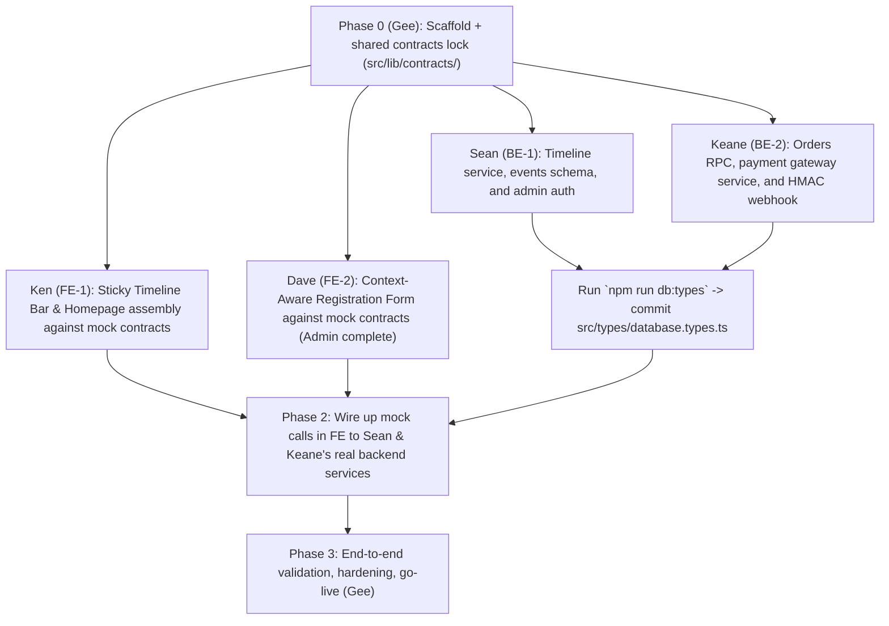

# TEAM_WORKFLOW.md — AI-Assisted Development Playbook (Gee, Ken, Dave, Sean, Keane)

> **How to use this file**: Each member of the PDD Website division has an isolated track, branch prefix, and ready-to-copy AI prompt. Paste your prompt into Claude Code / Antigravity / Cursor. Your agent must first read `AGENTS.md`, `docs/PRD.md`, and `docs/ARCHITECTURE.md` (and `docs/DESIGN.md` for UI work) to ensure seamless integration on the first try.

---

## 1. Team Tracks & Parallel Workstreams

| Track | Member | Branch Prefix | Primary Deliverables |
| :--- | :--- | :--- | :--- |
| **Coordination** | **Gee** | `chore/gee-*` | 1. Agent rules, project scope, schedule, docs, and config<br>2. Next.js + Supabase scaffold and shared contracts lock<br>3. Staging deployment, end-to-end testing, and release management |
| **Track FE-1 (Timeline Bar & Homepage)** | **Ken** (Kenneth Jonathan Halim) | `feat/fe-ken-*` | 1. **Sticky Timeline Bar** (`TimelineBar.tsx`): Pinned top bar connecting milestone nodes (Baksos $\rightarrow$ Ziarah $\rightarrow$ Webinar $\rightarrow$ YCR) with `PAST`, `NOW`, `UPCOMING` states<br>2. **Timeline Modal** (`TimelineModal.tsx`): Detail popup on node click and hover tooltip<br>3. **D-Day Mode**: Automatic transition to session-by-session YCR rundown when `Date.now() >= YCR_DATE_MIDNIGHT`<br>4. **Homepage Assembly** (`/`): Hosting Sticky Timeline Bar and Context-Aware Registration Form, plus site layout and footer |
| **Track FE-2 (Registration Form & Admin)** | **Dave** (Dave Tristian Nurcahyo) | `feat/fe-dave-*` | 1. **Registration Contract** (`src/lib/contracts/registration.contract.ts`)<br>2. **Context-Aware Registration Form** (`RegistrationForm.tsx`): Automatically switches between Webinar form (before `YCR_OPENS_AT`) and YCR form (on/after `YCR_OPENS_AT`)<br>3. **YCR Group Registration**: Pill selector (Individual vs Group), dynamic member addition/removal, and live tiered price summary (1–4: Rp 150k, 5–9: 10% off, $\ge$10: 20% off)<br>4. **Committee Admin & Gate Scanner** (`/admin`, `/admin/scan`): *Complete*<br>5. **Marketplace Placeholder** (`/marketplace`): Preserved as stub for future separate project |
| **Track BE-1 (Schema, Auth, Events & Timeline)** | **Sean** (Sean Lawton) | `feat/be-sean-*` | 1. PostgreSQL migrations for `events`, `event_milestones`, `event_sessions`, and `registrations`<br>2. Supabase SSR clients (`client.ts`, `server.ts`, `admin.ts`) & `/admin` auth middleware<br>3. Timeline service (`timeline.service.ts`) providing milestone nodes and D-Day rundown schedule<br>4. Registration check-in RPC (`verify_and_checkin_ticket`) for the admin gate scanner<br>5. Timeline API route: `GET /api/timeline` (src/app/api/timeline/route.ts) returning `EventTimelineResponse`. |
| **Track BE-2 (Orders, Payments & Webhooks)** | **Keane** (Keane Juan Suryanto) | `feat/be-keane-*` | 1. Migrations for `orders`, `order_items`, and `payment_logs`<br>2. Atomic registration order RPC (`register_ycr_group`) with quota check and server-side pricing calculation<br>3. Tripay / Midtrans payment gateway service (`payments.service.ts`)<br>4. Idempotent server webhook (`POST /api/webhooks/payment/route.ts`) verifying HMAC signature and activating registrations<br>5. Retain backend donation service and schema for marketplace use |

---

## 2. Step-by-Step Integration Order (Zero Blockers)



1. **Contract Lock (Phase 0)**: Shared contracts in `src/lib/contracts/` define the API boundaries before implementation.
2. **Parallel Build (Phase 1)**:
   - **Ken** builds the Sticky Timeline Bar with mock milestone and rundown data, verifying visual states and D-Day transition.
   - **Dave** builds the Context-Aware Registration Form with date-based switching, dynamic group member fields, and live price summary. (Admin and scanner are already done).
   - **Sean & Keane** implement database migrations, timeline services, registration RPCs, and payment webhook verification.
3. **Wire-Up (Phase 2)**: Replace mock data with Supabase services. Because both frontend and backend adhere to `src/lib/contracts/`, TypeScript guarantees type safety.
4. **Testing & Hardening (Phase 3)**: Verify gate scanning on mobile, payment webhooks in sandbox, and responsive layout across mobile and desktop.

---

## 3. Ready-to-Paste AI Prompts per Member

### For Ken — Frontend (Sticky Timeline Bar & Homepage Assembly)
```text
Read AGENTS.md, docs/PRD.md and docs/ARCHITECTURE.md first. Follow all ownership rules.
I am Ken (Frontend Track FE-1). Stay inside my assigned paths:
- src/components/timeline/ (TimelineBar.tsx, TimelineModal.tsx, mock-timeline.ts)
- src/components/layout/
- src/app/(public)/ or src/app/page.tsx

My deliverables:
1. Sticky Timeline Bar: Full-width horizontal bar pinned at top of the page (sticky on scroll). A progress line connects circular nodes left-to-right representing events in chronological order: Baksos, Ziarah, Webinar, YCR.
2. Node States: PAST = filled green, NOW = pulsing gold, UPCOMING = hollow with border.
3. Interactions: Hover shows tooltip with 1-line summary (title + date). Click opens TimelineModal with full event details (title, date, venue, description).
4. D-Day Mode: On and after YCR event date midnight (auto-detected by Date.now() >= YCR_DATE_MIDNIGHT), timeline automatically switches from milestones to the YCR session rundown (reusing the same bar and modal, displaying session schedule with speaker, location, time).
5. Homepage Assembly: Assemble the root page (/) containing the Sticky Timeline Bar at the top and Dave's Context-Aware Registration Form below it.
6. Mock data provider (src/components/timeline/mock-timeline.ts) using TimelineMilestone and RundownSession interfaces.
Use design tokens from src/app/tokens.css (Sunlit Highway theme). Mobile-first, min 44x44px touch targets.
```

### For Dave — Frontend (Context-Aware Registration Form & Admin)
```text
Read AGENTS.md, docs/PRD.md and docs/ARCHITECTURE.md first. Follow all ownership rules.
I am Dave (Frontend Track FE-2). Stay inside my assigned paths:
- src/components/registration/ (RegistrationForm.tsx, WebinarForm.tsx, YcrForm.tsx, PriceSummary.tsx)
- src/lib/contracts/registration.contract.ts
- src/app/admin/ and src/components/admin/ (Completed)
- src/app/marketplace/ and src/components/marketplace/ (Placeholder stub)
- src/app/mock-registration.ts

Note: /donate route and UI are deleted. Public donations are handled by the marketplace project.
My deliverables:
1. Registration Contract: Define src/lib/contracts/registration.contract.ts with MemberSchema, CreateWebinarRegistrationSchema, CreateYcrRegistrationSchema, and CreateYcrGroupSchema.
2. Context-Aware Registration Form:
   - Date-based switching: Before YCR_OPENS_AT date -> show Webinar registration form. On/after YCR_OPENS_AT -> show YCR registration form.
   - Webinar Form: Individual registration only (Full Name, Email, WhatsApp).
   - YCR Form: Pill selector toggle between Individual and Group.
     - Individual: Full Name, Email, WhatsApp.
     - Group: Leader row (Full Name, Email, WA) + "Add Member" button to append member rows with remove button (×).
   - Live Price Summary:
     - 1–4 people: Rp 150.000/person (placeholder)
     - 5–9 people: Rp 135.000/person (10% off placeholder)
     - >=10 people: Rp 120.000/person (20% off placeholder)
     - Total updates live as members are added or removed.
3. Embedded payment modal integration for paid YCR registrations via Tripay/Midtrans Snap.
4. Mock registration handler (src/app/mock-registration.ts) — validates Zod schema and returns CheckoutResult.
```

### For Sean — Backend (Schema, Auth, Events & Timeline)
```text
Read AGENTS.md, docs/PRD.md and docs/ARCHITECTURE.md first. Follow all ownership rules.
I am Sean (Backend Track BE-1). Stay inside my assigned paths:
- supabase/migrations/ (0001, 0003, 0004, 0006)
- src/lib/supabase/ (client.ts, server.ts, admin.ts)
- src/middleware.ts
- src/services/events.service.ts, src/services/registrations.service.ts, src/services/timeline.service.ts, src/services/admin.service.ts
- src/app/api/timeline/route.ts

My deliverables:
1. Migrations for events (Baksos, Ziarah, Webinar, YCR), event_milestones, event_sessions (D-Day rundown), and registrations with RLS.
2. Timeline service returning EventTimelineResponse (milestone nodes and D-Day rundown sessions).
3. Auth middleware protecting /admin for committee access.
4. Ticket verification and check-in RPC for Dave's gate scanner (/admin/scan).
5. Timeline API route (GET /api/timeline → EventTimelineResponse).
```

### For Keane — Backend (Orders, Registration Payments & Webhooks)
```text
Read AGENTS.md, docs/PRD.md and docs/ARCHITECTURE.md first. Follow all ownership rules.
I am Keane (Backend Track BE-2). Stay inside my assigned paths:
- supabase/migrations/ (0002, 0005)
- src/services/orders.service.ts, src/services/donations.service.ts, src/services/payments.service.ts
- src/app/api/webhooks/payment/route.ts

My deliverables:
1. Migrations for orders, order_items, payment_logs, and donations (retained for backend).
2. Atomic group registration RPC (register_ycr_group) locking quotas with SELECT ... FOR UPDATE and validating tiered pricing server-side.
3. Tripay / Midtrans payment gateway integration in payments.service.ts.
4. Idempotent webhook POST /api/webhooks/payment: verify HMAC signature, transition order to PAID, and generate ticket codes for all registered members.
```

---

## 4. Git & Contribution Rules

1. **One branch per task**, named with member prefix (`feat/fe-ken-*`, `feat/fe-dave-*`, `feat/be-sean-*`, `feat/be-keane-*`). Never commit directly to `main`.
2. **Strict file boundary compliance**: Operate strictly within assigned directories.
3. **Pre-merge validation**:
   - Run `npm run typecheck`, `npm run lint`, and `npm run build` locally before merging.
   - If database migrations were created, run `npm run db:types` and include updated types in the branch.
4. **No AI attribution** in commit messages or pull request descriptions.
5. **Environment Secrets**: Keep service role keys and payment secrets strictly on the server; never expose them with `NEXT_PUBLIC_`.
